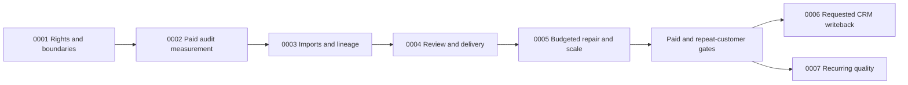

# Verify RFCs in priority order

Updated 2026-10-24 from the [company thesis](../../company.md), [vision](../../vision.md), and [codebase audit](../audits/2026-10-23-verify-north-star.md).

**RFC 0001 is highest priority; priority decreases through RFC 0033.** Filenames,
headings, references and navigation use this order. The [renumbering record](renumbering.md)
maps former identifiers from older issues and PRs to the current documents.
Dated Verify dispositions take precedence over historical baselines and proposals.

The destination is a repeatable paid audit of customer-owned prospect data: import
→ assess identity → selectively repair → verify → review → deliver Ready, Needs
Review and Excluded records → maintain approved data after repeat demand. Optimize
total cost per correctly matched, usable, role-relevant contact, including failures
and human review.

Read the [shared technical contracts](verify-technical-contracts.md) before
implementing RFCs 0001–0007. Their schemas, APIs, state machines, recovery rules,
migrations and acceptance gates are proposed designs, not claims of shipped behavior.

## Build order

The first seven RFCs define the core product sequence. RFCs 0008–0017 supply narrower
supporting or conditional work; extract their required slices within the core RFC
that needs them. RFCs 0018–0025 wait for separate demand. RFCs 0026–0031 document
existing foundations to reuse, and RFCs 0032–0033 are superseded references. Lower
priority for an implemented foundation means no new rebuild; its current behavior
remains a prerequisite where referenced. A demand gate still applies even when an
RFC appears earlier in the list.

| Priority | RFC | Status / scope | Next action and dependency |
|---|---|---|---|
| 1 | [0001 Data Rights and Product Boundaries](0001-data-rights-and-product-boundaries.md) | Stage 0a · proposed | Clear source rights, retention, deletion and product boundaries before expanded source use; existing tenant bridge is the starting point. |
| 2 | [0002 Paid Audit Validation and Unit Economics](0002-paid-audit-validation-and-unit-economics.md) | Stage 0b · proposed | Run scoped paid audits with full-cost and independent quality measurement; RFC 0001 gates real data. Continue measurement at every stage. |
| 3 | [0003 Agency Audits and Import Lineage](0003-agency-audits-and-import-lineage.md) | Stage 1a · proposed | Preserve client/campaign context, original IDs, field mappings and row lineage; depends on 0001 and 0002 identifiers. Preview makes no paid calls. |
| 4 | [0004 Evidence Review and Audit Delivery](0004-evidence-review-and-audit-delivery.md) | Stage 1b · proposed | Persist claim evidence and review decisions; deliver reconciled Ready, Needs Review and Excluded records. Depends on 0001/0003 and existing policy foundations. |
| 5 | [0005 Budgeted Selective Repair and Batch Execution](0005-budgeted-selective-repair-and-batch-execution.md) | Stage 2 · proposed | Approve priced repair plans, reserve budgets, reconcile provider outcomes and prove batch capacity; depends on 0001–0004. Extract admission controls before any automatic paid audit execution. |
| 6 | [0006 Preview-First HubSpot Writeback](0006-preview-first-hubspot-writeback.md) | Stage 3 · demand-gated | Preview and explicitly apply Verify-owned HubSpot properties for repeat buyers; depends on 0001/0003/0004 plus the 0013 cipher slice or equivalent. |
| 7 | [0007 Recurring Contact Quality](0007-recurring-contact-quality.md) | Stage 4 · demand-gated | Maintain approved cohorts with reviewed changes and bounded recurring spend; depends on 0001–0005 and repeat-payment economics. CRM delivery optionally uses 0006. |
| 8 | [0008 Person And Company Enrichment, And Job-Change Monitoring](0008-person-and-company-enrichment.md) | Supporting · split scope | Extract claim evidence for 0004, selective enrichment for 0005, and employment refresh for 0007; no standalone enrichment platform first. |
| 9 | [0009 Email Finder and Selective List Repair](0009-email-finder-parity.md) | Supporting · partial | Reuse existing Finder and bounded research for 0005. Add only repair adapters that improve the 0002 benchmark under 0001 rights. |
| 10 | [0010 Idempotent Integration UX](0010-idempotent-integration-ux.md) | Supporting · partial | Reuse durable verification operations/replay now; close cross-service idempotency gaps inside 0005 before broad integration UX work. |
| 11 | [0011 Suppression Scopes](0011-suppression-scopes.md) | Conditional · client isolation | Build client-specific suppression only when agencies need it; depends on 0003/0004. Use separate workspaces until isolation is implemented. |
| 12 | [0012 Bounce Reason Taxonomy](0012-bounce-reason-taxonomy.md) | Conditional · correctness | Promote recipient bounce classification for demonstrated wrong exclusions; preserve complaint/suppression gates. Sender alerts wait for 0019 demand. |
| 13 | [0013 Webhook Event Subscriptions And Delivery Log](0013-webhook-event-subscriptions.md) | Supporting · scoped prerequisite | Extract tenant credential storage before 0006; full webhook subscriptions and delivery logs require integration demand. |
| 14 | [0014 Reverification Policies by Segment](0014-reverification-policies-by-segment.md) | Supporting · partial | Reuse workspace reverification now; finish segment policies through 0007 after repeat demand. |
| 15 | [0015 Source-Level Quality Comparison](0015-source-level-quality-comparison.md) | Supporting · partial | Reuse source attribution/reporting for 0002 measurement. Existing shared sources-to-bulk authorization already works; no duplicate scope-fix task. |
| 16 | [0016 List Quality Scoring](0016-list-quality-scoring.md) | Supporting · partial | Reuse list aggregates/quality views; cached scorecards follow complete 0002 cost and contact-quality evaluation. |
| 17 | [0017 Mailbox Provider Breakdown For Each Campaign](0017-mailbox-provider-breakdown.md) | Conditional · attribution | Fix managed-provider MX attribution when it improves audit evidence; provider reports require suitable outcome data and customer demand. |
| 18 | [0018 Domain Search](0018-domain-search.md) | Deferred · narrow discovery | Promote bounded domain-source adapters only for measured 0002 coverage gaps, under 0005 rights/spend controls; a full Domain Search UI waits. |
| 19 | [0019 Scheduled Domain And IP Health Monitor](0019-domain-and-ip-health-monitor.md) | Deferred · sender workflow | Domain/IP monitoring needs sender demand, source terms and non-email alerts; it is not an audit dependency. |
| 20 | [0020 Bot Engagement Flag](0020-bot-engagement-flag.md) | Deferred · sender workflow | Engagement flags require 0017 attribution and real fixtures; engagement does not prove contact identity. |
| 21 | [0021 MCP Server](0021-mcp-server.md) | Deferred · agent channel | MCP requires channel demand, stable audit APIs, scoped auth and explicit paid-action approval. |
| 22 | [0022 Discover — Company And People Search](0022-discover-company-and-people-search.md) | Parked · broad acquisition | Company/people discovery needs repeat audit demand plus independent rights and economics evidence. |
| 23 | [0023 Signup Protection V2](0023-signup-protection-v2.md) | Parked · different buyer | Signup protection waits for demonstrated demand beyond the agency-audit buyer. |
| 24 | [0024 beehiiv And Kit Integrations](0024-beehiiv-and-kit-integrations.md) | Parked · newsletter workflow | beehiiv/Kit needs newsletter demand and 0011/0013 prerequisites; not a substitute for requested CRM handoff. |
| 25 | [0025 Postmaster Tools And SNDS Ingestion](0025-postmaster-tools-and-snds-ingestion.md) | Parked · sender data | Postmaster/SNDS needs sender demand, 0019/0017/0013, and confirmed provider/API access. |
| 26 | [0026 Verification Policy Modes](0026-verification-policy-modes.md) | Implemented baseline · maintain | Reuse current growth/deliverability/signup_protection/enterprise_strict/custom policy behavior in 0004; historical enum names are superseded. |
| 27 | [0027 Suppression Intelligence](0027-suppression-intelligence.md) | Implemented baseline · maintain | Reuse suppression reasons, provenance, expiry and events in 0004; never allow reviewer override of an active block. |
| 28 | [0028 Bulk Remediation Workflows](0028-bulk-remediation-workflows.md) | Implemented baseline · maintain | Reuse original-row and partition-export primitives in 0003/0004; preserve legacy export compatibility. |
| 29 | [0029 Tenant-Facing Job Observability](0029-tenant-facing-job-observability.md) | Implemented baseline · maintain | Reuse job events, retries and failure/latency views; extend research progress only as needed by 0005. |
| 30 | [0030 Deliverability Feedback and Recommendations](0030-deliverability-feedback-and-recommendations.md) | Implemented baseline · maintain | Reuse recommendations and feedback policy in 0004; sending advice is not person-identity evidence. |
| 31 | [0031 Native Provider Webhooks and Outcome Adapters](0031-native-provider-webhooks-and-outcome-adapters.md) | Implemented baseline · maintain | Preserve ESP outcome adapters and receipts; reconcile demonstrated gaps when the audit needs them. |
| 32 | [0032 Data Platform Foundations](0032-data-platform-foundations.md) | Superseded architecture · reference | The Go bridge exists. Remaining rights/budgets/scale belong to 0001/0005; do not build a second Rust crawler or global contact store. |
| 33 | [0033 Deliverability Intelligence Roadmap](0033-deliverability-intelligence-roadmap.md) | Superseded roadmap · reference | Historical deliverability inventory only. This numbered index controls current priority. |

## Core delivery gates

RFC 0002 continues across every stage. Before broader investment require **five
paid audits, three repeat-paying customers, positive contribution margin**, and a
pre-registered improvement in correctly matched approved contacts or manual cleanup
time without sacrificing quality. The approximately 1,200-account, three-segment
benchmark is a future target. The $249 audit and $149–$299 recurring offer are
experiments, not deployed entitlements.

Each increment must deliver usable value before expansion. A rights-cleared manual
audit can use the existing pilot and controlled approval/cost ledger while automation
is built. No broad discovery UI, sender dashboard, MCP service or CRM connector
blocks that pilot. Current automated limits remain ten companies, three candidates
per company and thirty verifications per run until RFC 0005's gates pass.

Requested CRM work can use reviewed CSV-era audits without full automated repair
if repeat demand and its own prerequisites are proven. Rights checks and measurement
continue throughout. “Implemented baseline” means inspected code provides a central
primitive; it does not certify every historical criterion or live deployment.

## Completion rules

For each promoted RFC, name an owner and exact incremental scope. Record API/SDK
compatibility, tenant/role authorization, retry and budget failure behavior,
representative workflow tests, and customer/metric outcomes. Use additive migrations
and feature flags where appropriate. Distinguish source inspection, mock tests,
deployed checks, and customer evidence. Update this index and the RFC disposition
together; a related primitive does not mean the complete proposal shipped.
